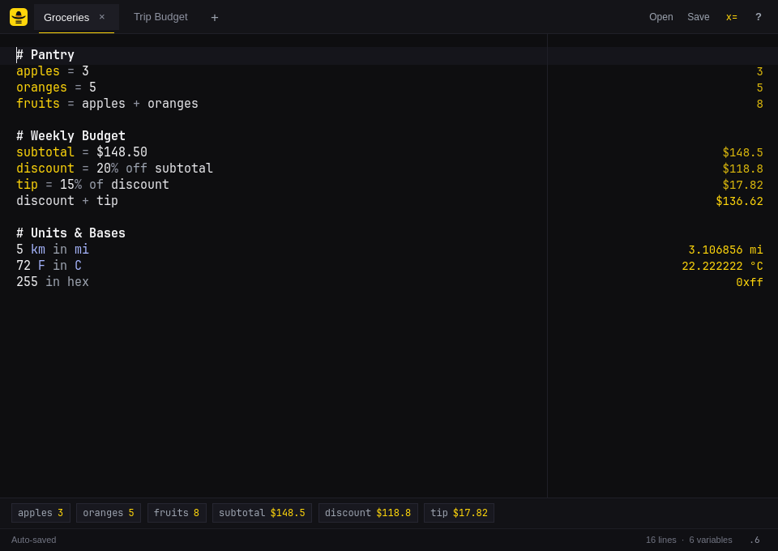

# Numbrero Bar Plugin (`io.github.joonsp.numbrero`)



A lightweight Omarchy shell bar widget and quick-calc popup with a built-in pure-JS evaluator, automatically enhanced by the native [Numbrero](https://github.com/joonsp/numbrero) app when installed.

- **Works out of the box:** evaluates variables, math functions, currencies (`$`, `€`, `£`, `¥`, `kr`), percentages (`20% of 150`, `20% off $150`), base conversions (`255 in hex`), and unit conversions (`5 km in mi`, `72 F in C`) immediately even without the native app installed.
- **Left-click** the monochrome sombrero bar icon to open the quick calculator popup and see live variable values listed below.
- **Click any variable chip** to copy its value to the clipboard.
- **Open App / Get Full App:** launches the full multi-sheet desktop app if `numbrero` is installed, or opens <https://github.com/joonsp/numbrero> if not.

## Dependencies

- `wl-copy` (`wl-clipboard`) for click-to-copy
- Optional: `numbrero` CLI/app binary on `PATH` from <https://github.com/joonsp/numbrero>

No sudo or pkexec is required.

## Installation

```bash
omarchy plugin add https://github.com/joonsp/omarchy-numbrero.git --enable
```

## Removal

```bash
omarchy plugin disable io.github.joonsp.numbrero
omarchy plugin remove io.github.joonsp.numbrero
```

## License

[MIT License](LICENSE)
